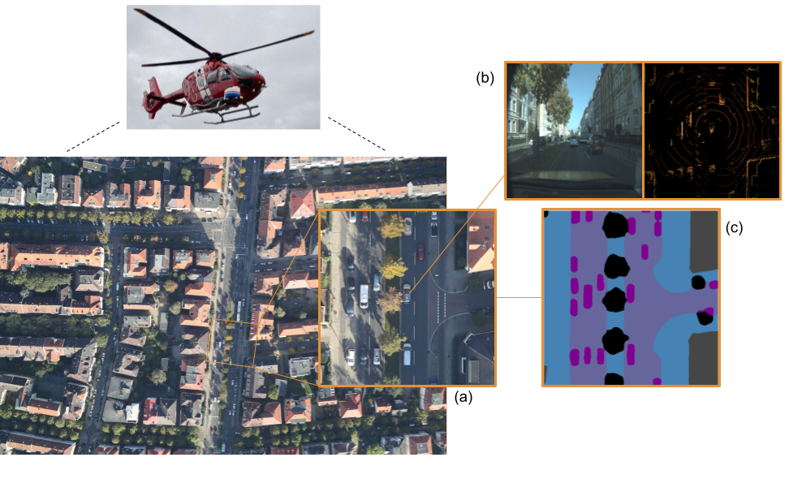
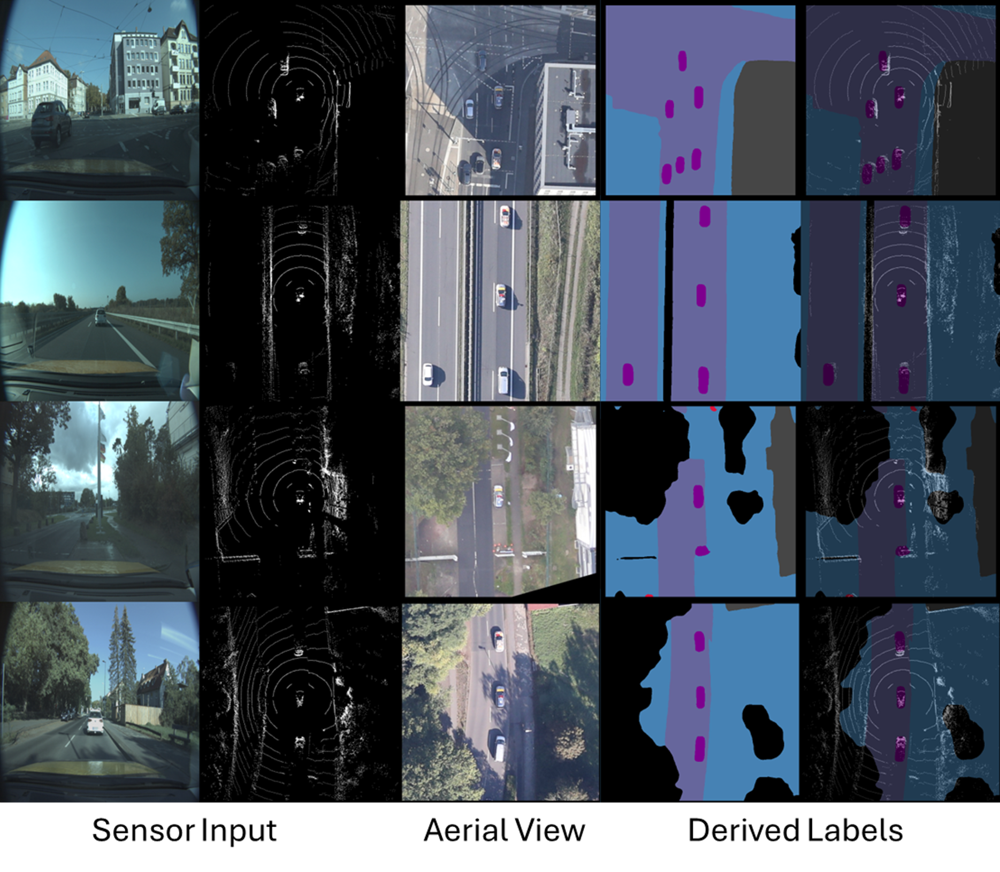
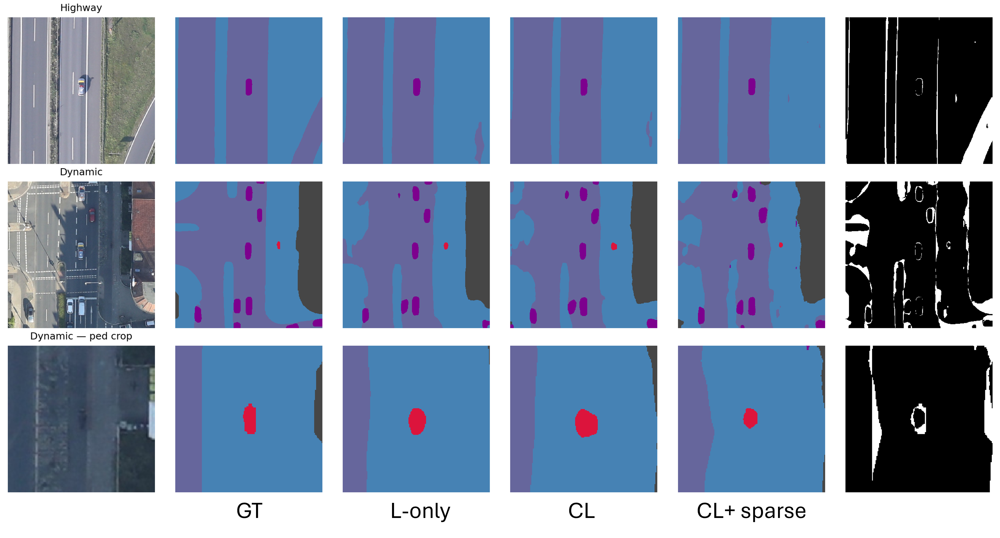

# GOLD-BEV

<p align="center">
  <b>GrOund and aeriaL Data for Dense Semantic BEV Mapping of Dynamic Scenes</b>
</p>

<p align="center">
  <a href="https://arxiv.org/abs/2604.19411"><b>Paper</b></a>
  &nbsp;·&nbsp;
  <a href="DATASET_DOWNLOAD_URL"><b>Download Dataset</b></a>
  &nbsp;·&nbsp;
  <a href="https://creativecommons.org/licenses/by-nc/4.0/"><b>License</b></a>
</p>

<p align="center">
  Joshua Niemeijer · Alaa Eddine Ben Zekri · Reza Bahmanyar · Philipp M. Schmälzle · Houda Chaabouni-Chouayakh · Franz Kurz
</p>

<p align="center">
  
</p>

## Overview

**GOLD-BEV** is a cross-view dataset of time-synchronized aerial and ego-centric sensor observations for dense semantic bird's-eye-view (BEV) mapping of dynamic road scenes.

A helicopter-mounted camera captures high-resolution overhead RGB imagery while an instrumented vehicle simultaneously records a front-facing RGB camera, multiple LiDAR sensors, and GNSS/INS measurements. The synchronized aerial view provides a dense, geometrically aligned observation of the same dynamic scene seen from the vehicle.

The dataset contains **8,199 synchronized samples** collected across approximately **60 km of urban, suburban, and highway driving**. GOLD-BEV supports research on ego-to-BEV reconstruction, dense semantic BEV mapping, cross-view learning, and aerial supervision for dynamic road scenes.

## Qualitative Samples

The examples below show synchronized ground RGB and LiDAR observations together with the corresponding vehicle-centered aerial crop and dense semantic BEV supervision.

<p align="center">
  
</p>

GOLD-BEV uses five semantic classes: **road, sidewalk, building, vehicle, and vulnerable road user (VRU)**.

### BEV predictions

Example dense BEV semantic predictions for highway and complex urban scenes:

<p align="center">
  
</p>

## Dataset Download

The GOLD-BEV dataset is available here:

<p align="center">
  <a href="DATASET_DOWNLOAD_URL"><b>Download GOLD-BEV</b></a>
</p>

> **Before publishing:** replace `DATASET_DOWNLOAD_URL` in this README with the final dataset URL.

## Paper

**GOLD-BEV: GrOund and aeriaL Data for Dense Semantic BEV Mapping of Dynamic Scenes**

Joshua Niemeijer, Alaa Eddine Ben Zekri, Reza Bahmanyar, Philipp M. Schmälzle, Houda Chaabouni-Chouayakh, and Franz Kurz.

[Read the paper on arXiv](https://arxiv.org/abs/2604.19411)

## Citation

```bibtex
@misc{niemeijer2026goldbev,
  title         = {GOLD-BEV: GrOund and aeriaL Data for Dense Semantic BEV Mapping of Dynamic Scenes},
  author        = {Niemeijer, Joshua and Ben Zekri, Alaa Eddine and Bahmanyar, Reza and Schmälzle, Philipp M. and Chaabouni-Chouayakh, Houda and Kurz, Franz},
  year          = {2026},
  eprint        = {2604.19411},
  archivePrefix = {arXiv},
  primaryClass  = {cs.CV}
}
```

## License

The GOLD-BEV dataset is licensed under the **Creative Commons Attribution-NonCommercial 4.0 International License (CC BY-NC 4.0)**.

See [`LICENSE`](LICENSE) and the [Creative Commons license page](https://creativecommons.org/licenses/by-nc/4.0/) for details.

---

<p align="center">
  German Aerospace Center (DLR) · Institute of AI Safety and Security
</p>
